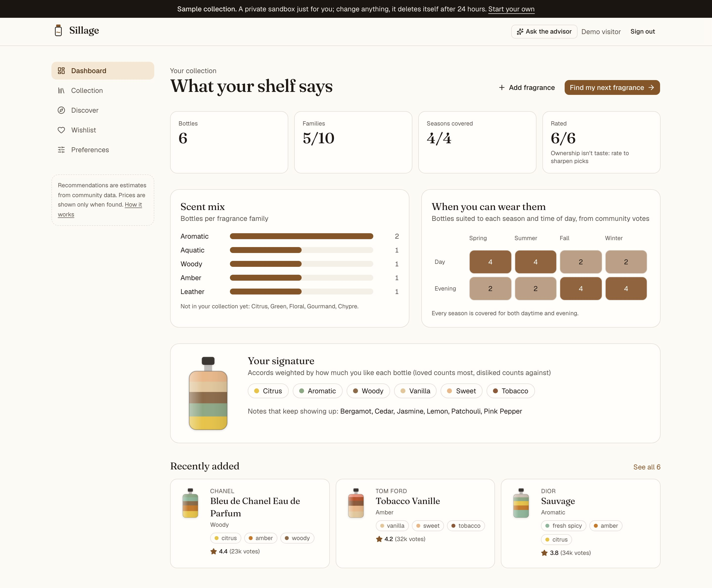
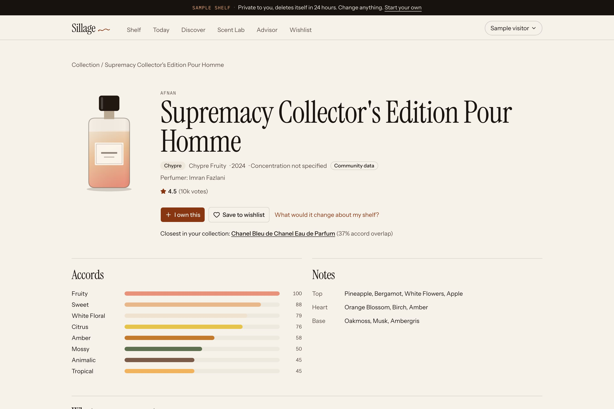

# Sillage

**Know your shelf. Find your next bottle.** A fragrance collection manager with a grounded AI advisor: it maps what you own, explains your taste, recommends what to try next with reasons and caveats, and checks prices for the exact bottle.

### ▶ [Try the live demo](https://sillage-rosy.vercel.app)
Click **"Try the live demo, no sign-up"** and you get a private sample collection: six bottles, a wishlist item and a saved preference. The walkthrough takes about two minutes, and the sandbox deletes itself after 24 hours.

---

## Why this exists

Collectors with a dozen bottles still buy the wrong next one: a fifth fresh blue scent, the EDT when they wanted the EDP, a "deal" that's actually a tester. The tools don't connect. Fragrantica knows every perfume but not your shelf. A spreadsheet knows your shelf but suggests nothing. A chatbot recommends confidently, doesn't know what you own, and will invent a price.

Sillage's bet: **recommendations get far more relevant when they start from what you own and what you've said you like, and they're only trustworthy when every claim traces back to data.** That's a hypothesis, not a finding. I haven't interviewed users yet; the [case study](docs/product/CASE-STUDY.md) says so plainly.

## What it does

| | |
|---|---|
| **1. Your shelf, understood.** Add bottles from ~38,000 fragrances (typos are fine). The dashboard shows your family mix, which seasons and times of day you can cover, and your "signature" accords, weighted by how much you like each bottle. | **2. Three ways to discover.** *Similar* (more of what you love), *Different* (a new direction that still fits), *Fill gaps* (what your shelf is missing). Every pick shows why, what's uncertain, and a score breakdown. |
|  |  |
| **3. An advisor that can't make things up.** Ask in plain English. A Claude agent reads your collection, runs the same engine, and explains. Every answer shows its tool calls, cost and a grounding check. | **4. Prices for the exact bottle.** Pick concentration and size. Testers, flankers, wrong sizes and gift sets are rejected, and the page says what was hidden and why. |
|  |  |

## The AI design (the part I'd talk about in an interview)

- **Deterministic ranking, AI explanation.** A tested engine scores candidates on taste fit, the mode's goal, budget, season/time of day and performance, and emits reason codes and caveats. The model can't add candidates or change scores.
- **Output contract enforced in code.** The agent cites fragrances by id. Any id that didn't come from a tool in that turn, and any price not in a tool result, is stripped before you see it and counted in the trace.
- **No silent writes.** Saving or changing preferences goes through "propose" tools that render a confirm button. Third-party text is labelled untrusted data.
- **One agent, eight strict tools, bounded cost.** At most six tool rounds, low effort, prompt caching, per-user rate limits; per-answer tokens, latency and cost are visible.
- **Fails safe.** Without a key, or on an error or decline, a rule-based mode answers with the same engine and says so.

## Evals, and what they changed

Cases and pass criteria were written **before** the first run ([report](docs/evals/REPORT.md), and a public `/evals` page in the app).

| | v1 | v2 |
|---|---|---|
| Offer matching precision (61 adversarial listings) | 83.3% | **100%** (recall 100%) |
| Recommendation personas passing | 27/30 | **29/32** (2 cases added for budget alternatives; exclusions 100%) |
| Planted fake ids/prices reaching users | 0/7 | **0/7** |
| Common bottles found by name | 20/20 | 20/20 |

v1 matched "Khamrah *Qahwa*" as the same bottle as Khamrah, recommended flankers of bottles people already owned, and kept "Different" inside the same family. Each fix is a logged decision. The remaining failures (the engine prefers close alternatives from smaller houses over the famous names I annotated) became a product decision instead of a tuning exercise: users now choose whether to see **budget alternatives**, and they're always labelled with what they resemble.

## Product docs

| Document | What's in it |
|---|---|
| [Case study](docs/product/CASE-STUDY.md) | The problem, the bets, the trade-offs, what evals changed, what's unproven |
| [PRD](docs/specs/01_Sillage_PRD.md) · [Architecture](docs/specs/02_Architecture_Data_Model.md) · [UX flows](docs/specs/03_UX_User_Flows.md) · [QA plan](docs/specs/04_QA_Traceability.md) | The spec pack the build was checked against |
| [Decision register](docs/DECISIONS.md) | 33 decisions with the reason for each, and how the open questions were resolved |
| [Traceability](docs/TRACEABILITY.md) | Every requirement → code → the tests that prove it |
| [Eval report](docs/evals/REPORT.md) | Every case and result, regenerated by `npm run evals` |
| [Build log](docs/evidence/BUILD-LOG.md) | What testing caught along the way |

## How it was built

I worked as product owner with an AI coding agent (Claude Code) as the engineer, from a seven-document spec pack. I made the product calls (data sources under a zero-cost constraint, model, scope); the agent proposed defaults for the rest and logged every one. Each stage ended with evidence: tests run, numbers measured, bugs written down.

**Stack:** Next.js 16 (App Router) + TypeScript, Supabase (Postgres, Auth, row-level security), Claude API (tool use), Zod, Tailwind + shadcn/ui. Tested with Vitest, pgTAP and Playwright (+ axe).

**Data:** ~38k fragrances with notes, accords and community votes from Fragrantica's public catalogue via the open [Decant dataset](https://codeberg.org/decant/pages) (downloaded at build, never committed; facts and aggregates only, every page links to its source); live fallback to [Open Beauty Facts](https://world.openbeautyfacts.org); optional live prices from Google Shopping via SerpApi. No images are licensed, so each fragrance is drawn as a "scent fingerprint" from its accords.

**Quality at the time of writing:** 54 unit tests, 38 database security assertions, 11 end-to-end tests (desktop + mobile, WCAG 2.2 AA scan on 13 screens and states, keyboard-only flow), production build and a check that no server secret reaches the browser bundle.

## Status and honest caveats

- MVP portfolio project, deployed on Vercel + Supabase (free tiers). Not yet tested with real users.
- Without an Anthropic key the advisor runs in offline rule-based mode; without a SerpApi key, prices are labelled samples from fictional stores.
- Notes, seasons and longevity are community votes, shown as estimates. Price bands are brand-level estimates, always labelled.
- Not affiliated with Fragrantica or any retailer; no affiliate links.

## Running it locally

See [docs/DEVELOPMENT.md](docs/DEVELOPMENT.md) (Node 22 + Docker). Deployment steps: [docs/DEPLOY.md](docs/DEPLOY.md).

---
Built by **Aditya Hasija**, product manager.
