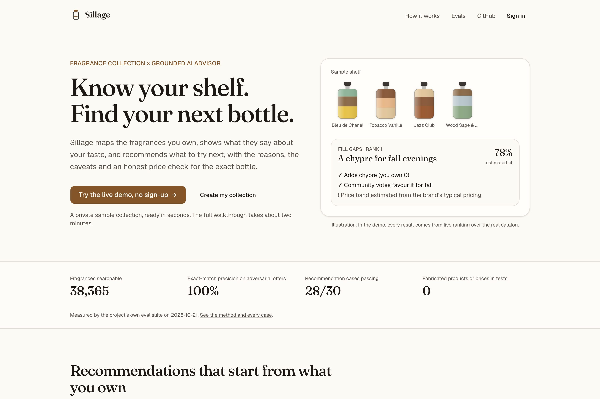
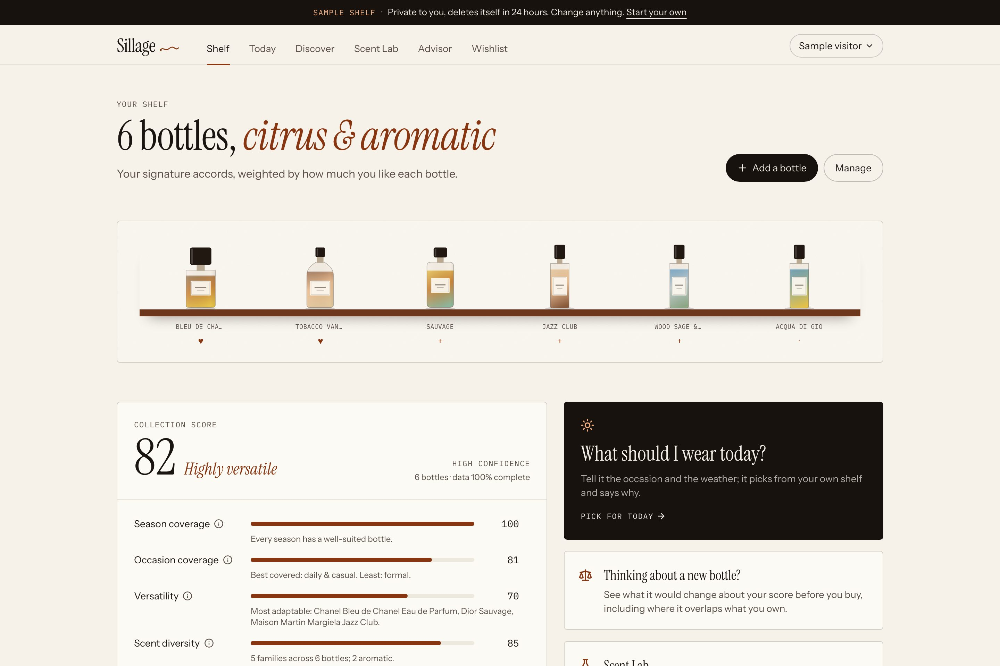
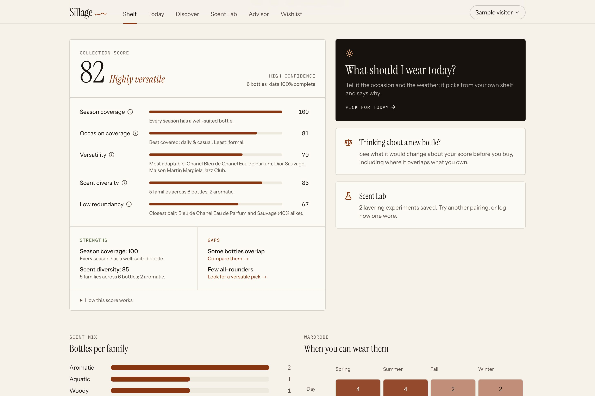
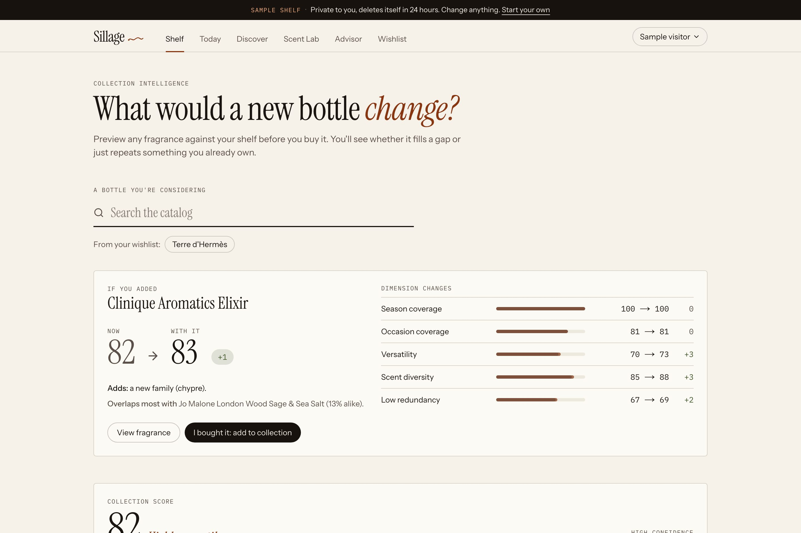
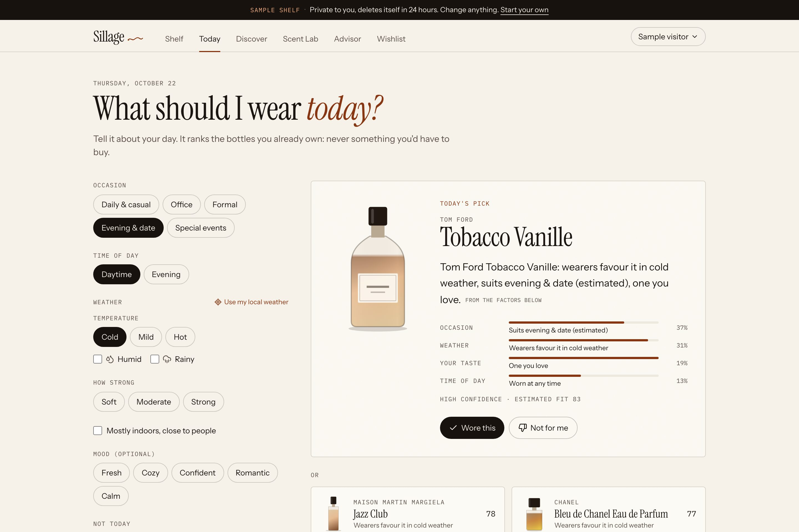
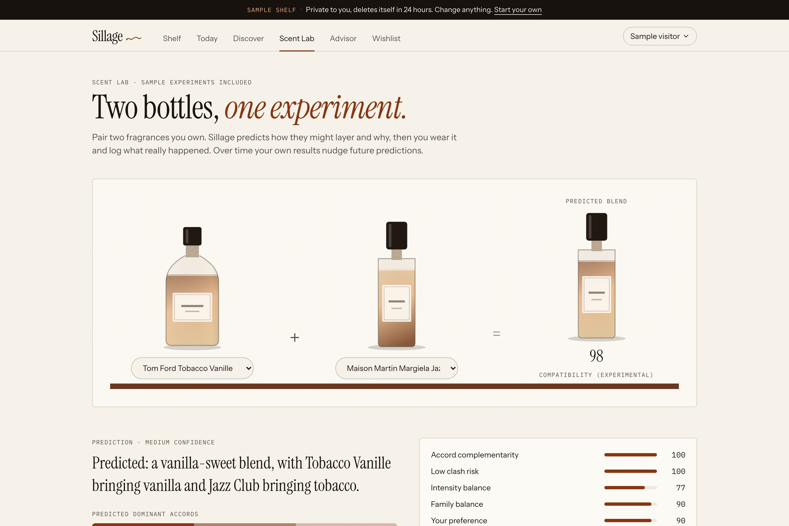
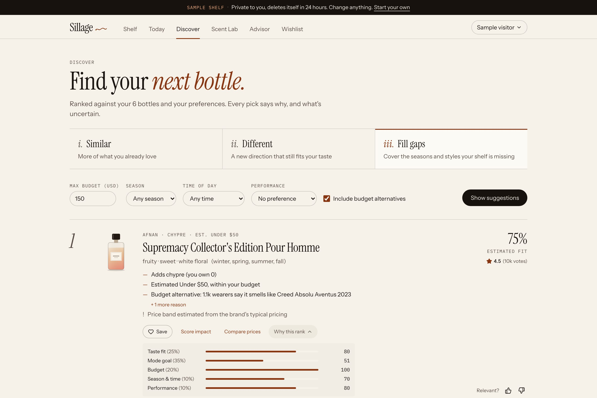
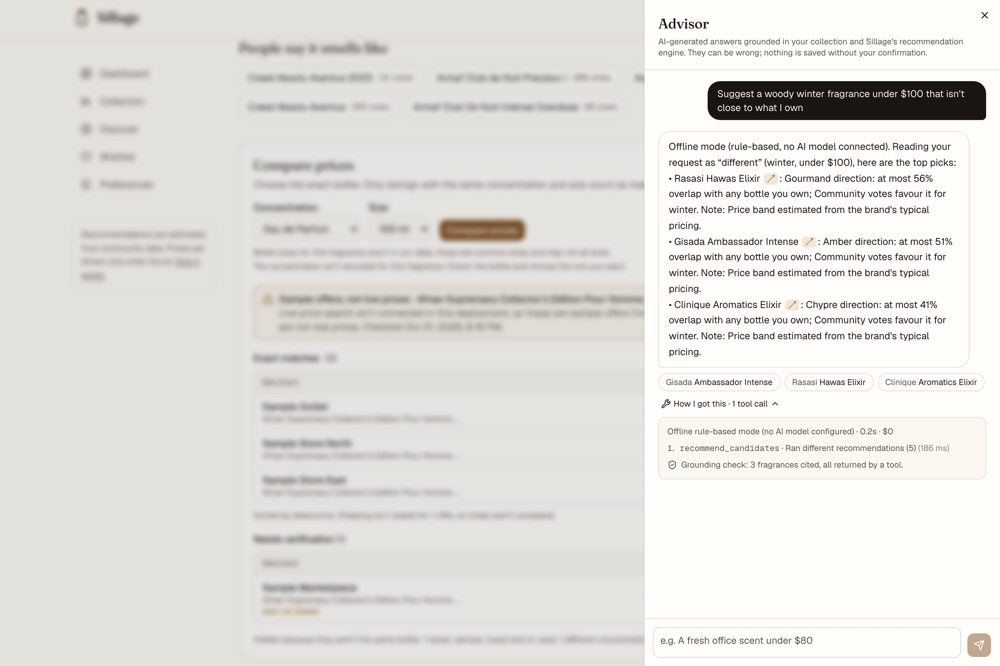
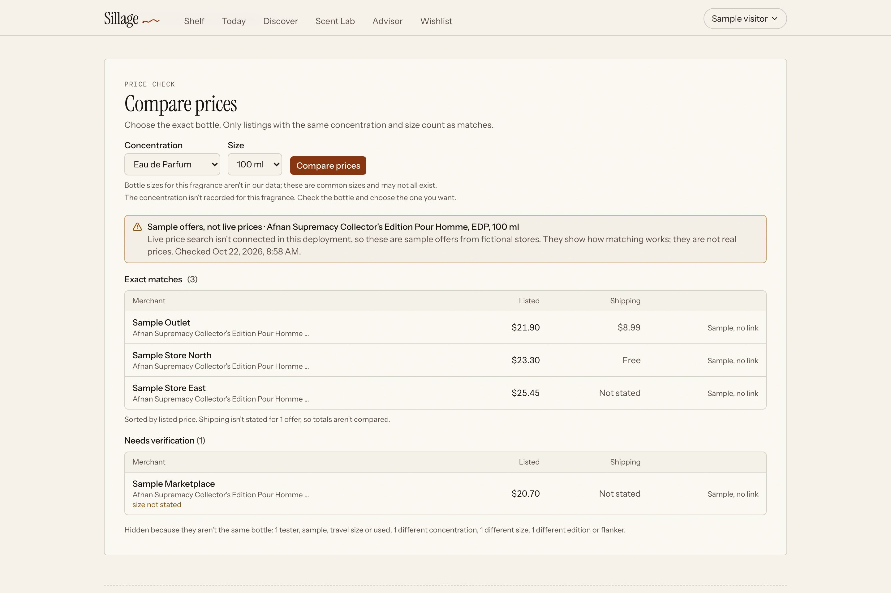
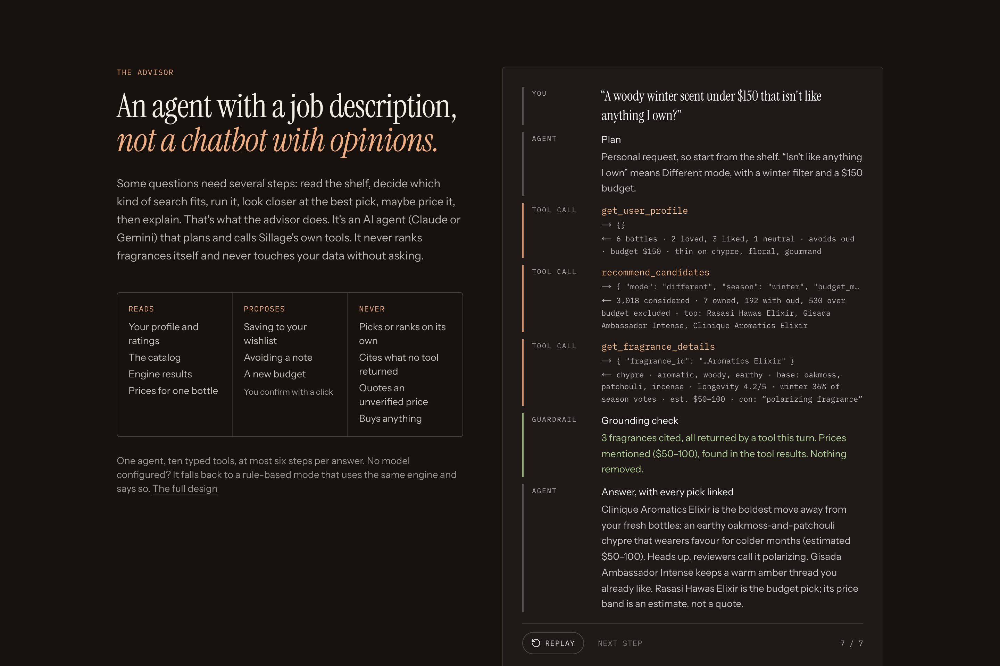

# Sillage

**Know your shelf. Wear it better. Buy the next bottle for a reason.** A fragrance collection manager with a grounded AI agent: it maps what you own, scores how well the collection covers your life, picks what to wear today, predicts how two bottles might layer, recommends what to try next with reasons and caveats, and checks prices for the exact bottle.

### ▶ [Try the live demo](https://sillage-rosy.vercel.app)
Click **"Open a sample shelf"** (no sign-up) and you get a private sample collection: six bottles, a wishlist item, a saved preference and two layering experiments. The walkthrough takes about two minutes, and the sandbox deletes itself after 24 hours.

---

## Why this exists

Collectors with a dozen bottles still buy the wrong next one: a fifth fresh blue scent, the EDT when they wanted the EDP, a "deal" that's actually a tester. The tools don't connect. Fragrantica knows every perfume but not your shelf. A spreadsheet knows your shelf but suggests nothing. A chatbot recommends confidently, doesn't know what you own, and will invent a price.

Sillage's bet: **recommendations get far more relevant when they start from what you own and what you've said you like, and they're only trustworthy when every claim traces back to data.** That's a hypothesis, not a finding. I haven't interviewed users yet; the [case study](docs/product/CASE-STUDY.md) says so plainly.

**The value, in one line per user moment:**

| Moment | Without Sillage | With Sillage |
|---|---|---|
| "Should I buy this?" | Hype, a video review, a guess | The score impact on *your* shelf: what it adds, what it repeats |
| "What do I wear today?" | The same bottle again | A ranked pick from bottles you own, for the occasion and the weather, with reasons |
| "Would these two layer?" | Spray and hope | A labelled prediction from accord rules, then your own logged result |
| "Where do I buy it?" | Five tabs, a tester posing as new | Exact-variant offers only, with what was hidden and why |

## What it does

| | |
|---|---|
| **1. Your shelf, understood.** Add bottles from ~38,000 fragrances (typos are fine). The shelf shows your bottles, your family mix, which seasons and times of day you can cover, and your "signature" accords, weighted by how much you like each bottle. | **2. Collection Score.** A 0–100 score across five explained dimensions (season, occasion, versatility, diversity, redundancy) with strengths, gaps and a link to fix each gap. Missing data lowers confidence instead of being scored as zero. |
|  |  |
| **3. "What would it change?"** Preview any fragrance against your shelf before buying: Now → With it, per-dimension deltas, and the bottle it overlaps most. A near-copy of something you own is flagged as a duplicate. | **4. Today.** Tell it the occasion, time of day and weather (or share local weather once, never stored). It ranks only bottles you own, explains the pick, and learns from "Wore this" and "Not for me", within bounds. |
|  |  |
| **5. Scent Lab.** Pair two bottles you own. Sillage predicts the blend's character, what might work and what might clash, from an editable accord ruleset. It's labelled experimental, never "high confidence", and your own logged wears nudge future predictions. | **6. Three ways to discover.** *Similar*, *Different*, *Fill gaps*. Every pick shows why, what's uncertain, and a score breakdown, plus a link to its score impact. |
|  |  |
| **7. An advisor agent that can't make things up.** Ask in plain English. An AI agent (Gemini on its free tier, or Claude) plans, calls Sillage's own tools, and explains. Every answer shows its tool calls, cost and a grounding check. | **8. Prices for the exact bottle.** Pick concentration and size. Testers, flankers, wrong sizes and gift sets are rejected, and the page says what was hidden and why. |
|  |  |

## The agent (the part I'd talk about in an interview)

**Why an agent at all.** Some questions take several dependent steps: "a woody winter scent under $150 that isn't like anything I own" means reading the shelf, choosing *Different* mode with a season and budget, running the engine, inspecting the best pick, maybe pricing it, then explaining. A single prompt can't do that reliably; a fixed pipeline can't handle the variety of questions. **Why only one agent.** The job has one actor and one context. Multi-agent orchestration would add cost, latency and failure modes without adding capability.

**What it can do: 10 typed tools, split by permission.**

| Reads (runs on its own) | Proposes (you confirm with a click) | Never |
|---|---|---|
| `get_user_profile`, `get_owned_fragrances`, `search_catalog`, `get_fragrance_details`, `recommend_candidates`, `find_offers`, `get_collection_score`, `pick_for_today` | `propose_add_to_wishlist`, `propose_preference_update` | Ranks on its own, cites what no tool returned, quotes an unverified price, buys anything, writes without a click |

- **Deterministic ranking, AI explanation.** The engines (recommendations `rec-1.2`, score `score-1.0`, daily `daily-1.0`, lab `lab-1.0`) are pure, versioned and tested. The model can't add candidates or change scores.
- **Output contract enforced in code.** The agent cites fragrances by id. Any id that didn't come from a tool in that turn, and any price not in a tool result, is stripped before you see it and counted in the trace.
- **Bounded.** At most six tool rounds, low effort, prompt caching, per-user rate limits; per-answer tokens, latency and cost are visible.
- **Narrow AI elsewhere.** Today's pick can be phrased by the model, but the phrasing is validated (must name the pick, no new numbers, no prices) or it falls back to a template, and the UI says which one you're reading.
- **Fails safe.** Without a key, or on an error or decline, a rule-based mode answers with the same engines and says so.
- **Model-agnostic, free to run.** The agent loop, tools, grounding check and trace are provider-neutral; Gemini and Claude are two adapters behind them. It runs on Gemini's free tier today and switches to Claude with one environment variable. A live eval (`npm run evals`, 8 prompts with expectations written first) measures whichever model is configured.

The full design (the loop, every tool, the guardrails and failure modes) is on the [How it works](https://sillage-rosy.vercel.app/how-it-works#advisor) page.

## Evals, and what they changed

Cases and pass criteria were written **before** the first run ([report](docs/evals/REPORT.md), and a public `/evals` page in the app).

| | v1 | v5 (latest) |
|---|---|---|
| Offer matching precision (61 adversarial listings) | 83.3% | **100%** (recall 100%) |
| Recommendation personas passing | 27/30 | **29/32** (2 cases added for budget alternatives; exclusions 100%) |
| Planted fake ids/prices reaching users | 0/7 | **0/7** |
| Common bottles found by name | 20/20 | 20/20 |
| Collection Intelligence checks (determinism, duplicates, owned-only picks, lab bounds) | n/a | **9/9** |

The Collection Intelligence tests also caught real bugs before shipping: layering scores saturated at 100 for unrelated pairs (recalibrated; real pairs now spread 44–98), confidence stayed "high" when whole dimensions were missing, and tied seasons produced "strongest in fall; thinnest in fall". All are in the [build log](docs/evidence/BUILD-LOG.md).

v1 matched "Khamrah *Qahwa*" as the same bottle as Khamrah, recommended flankers of bottles people already owned, and kept "Different" inside the same family. Each fix is a logged decision. The remaining failures (the engine prefers close alternatives from smaller houses over the famous names I annotated) became a product decision instead of a tuning exercise: users now choose whether to see **budget alternatives**, and they're always labelled with what they resemble.

## Product docs

| Document | What's in it |
|---|---|
| [Case study](docs/product/CASE-STUDY.md) | The problem, the bets, the trade-offs, what evals changed, what's unproven |
| [Collection Intelligence PRD](docs/specs/08_Collection_Intelligence_PRD.md) · [Implementation plan](docs/INTELLIGENCE-PLAN.md) | Score, Today and Scent Lab: requirements, acceptance tests CS/DS/SL-01..07, the plan and the audit |
| [PRD](docs/specs/01_Sillage_PRD.md) · [Architecture](docs/specs/02_Architecture_Data_Model.md) · [UX flows](docs/specs/03_UX_User_Flows.md) · [QA plan](docs/specs/04_QA_Traceability.md) | The spec pack the build was checked against |
| [Decision register](docs/DECISIONS.md) | 49 decisions with the reason for each, and how the open questions were resolved |
| [Traceability](docs/TRACEABILITY.md) | Every requirement → code → the tests that prove it |
| [Eval report](docs/evals/REPORT.md) | Every case and result, regenerated by `npm run evals` |
| [Build log](docs/evidence/BUILD-LOG.md) | What testing caught along the way |

## How it was built

I worked as product owner with an AI coding agent (Claude Code) as the engineer, from a seven-document spec pack, then a second PRD for Collection Intelligence. I made the product calls (data sources under a zero-cost constraint, model, scope); the agent proposed defaults for the rest and logged every one. Each stage ended with evidence: tests run, numbers measured, bugs written down.

**Stack:** Next.js 16 (App Router) + TypeScript, Supabase (Postgres, Auth, row-level security), Gemini API (free tier) or Claude API, both through the same tool loop; Zod, Tailwind + shadcn/ui. Tested with Vitest, pgTAP and Playwright (+ axe).

**Data:** ~38k fragrances with notes, accords and community votes from Fragrantica's public catalogue via the open [Decant dataset](https://codeberg.org/decant/pages) (downloaded at build, never committed; facts and aggregates only, every page links to its source); live fallback to [Open Beauty Facts](https://world.openbeautyfacts.org); optional live prices from Google Shopping via SerpApi. No images are licensed, so each fragrance is drawn as a "scent fingerprint" from its accords.

**Design:** an editorial look of its own (Instrument Serif, paper and ink, cognac accents, drawn bottles whose shape and tint come from each fragrance's name and accords), deliberately distinct from my other portfolio project. Weather comes from [Open-Meteo](https://open-meteo.com) (free, no key), opt-in, coordinates rounded and never stored.

**Quality at the time of writing:** 101 unit tests, 62 database security assertions (row-level security on every new table), 14 end-to-end tests (desktop + mobile, WCAG 2.2 AA scan on every app screen including Today, Scent Lab, Score and Advisor, keyboard-only flow), production build and a check that no server secret reaches the browser bundle.

## Status and honest caveats

- MVP portfolio project, deployed on Vercel + Supabase (free tiers). Not yet tested with real users.
- The advisor runs on Gemini's free tier (`GEMINI_API_KEY`), or on Claude if an Anthropic key is set. With no key, or once the free quota is used up, it answers in a labelled rule-based mode. Google may use free-tier requests to improve its products; the privacy page says so.
- without a SerpApi key, prices are labelled samples from fictional stores.
- Notes, seasons and longevity are community votes, shown as estimates. Occasion fit (office, formal, date) is *inferred* from accords and day/night votes and labelled that way; the score weights are a reasoned starting point, not industry-validated.
- Scent Lab predictions are heuristics from an accord ruleset, labelled experimental. They are not chemistry and not an optimal ratio. Price bands are brand-level estimates, always labelled.
- Not affiliated with Fragrantica or any retailer; no affiliate links.

## Running it locally

See [docs/DEVELOPMENT.md](docs/DEVELOPMENT.md) (Node 22 + Docker). Deployment steps: [docs/DEPLOY.md](docs/DEPLOY.md).

---
Built by **Aditya Hasija**, product manager.
