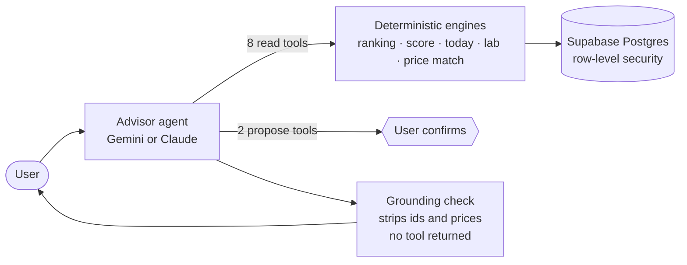

# Sillage

**Know your shelf. Wear it better. Buy the next bottle for a reason.**

A fragrance collection manager with a grounded AI agent, built end to end as a product-management portfolio project.

[**▶ Open the live demo**](https://sillage-rosy.vercel.app) (no sign-up, about 2 minutes) · [Case study](docs/product/CASE-STUDY.md) · [One-pager](docs/product/ONE-PAGER.md) · [PRD](docs/product/PRD.md) · [Public evals](https://sillage-rosy.vercel.app/evals)

---

## The 60-second version

| | |
|---|---|
| **Problem** | Collectors with a dozen bottles still buy the wrong next one (a fifth fresh blue scent, the EDT when they wanted the EDP, a "deal" that's a tester) and wear the same bottle every day. Fragrantica knows every perfume but not your shelf; chatbots don't know your shelf and will invent a price. |
| **Product** | Start from what you own. Sillage scores how well your collection covers your life, picks what to wear today, predicts how two bottles might layer, recommends what to buy next with reasons and caveats, and checks prices for the exact bottle. An AI agent ties it together in plain English. |
| **AI design** | One agent, ten typed tools, deterministic engines underneath. The model plans and explains; tested code ranks, scores and matches. Anything a tool didn't return is removed before you see it. Runs free on Gemini, or on Claude with one key. |
| **My role** | Product owner, end to end: two spec-first PRDs, 61 logged decisions, eval criteria written before the first run, a UX audit, and launch on production. Built with Claude Code as the engineer. |
| **Evidence** | 38,365-fragrance open catalog · exact-bottle price matching at **100% precision** on 61 adversarial listings (up from 83%) · **0 of 7** planted fake products or prices reached users · 119 unit, 62 database-security and 14 end-to-end tests including a WCAG 2.2 AA scan. |
| **Honest status** | Live MVP on free tiers. Not yet tested with real users; the bet below is a hypothesis, and the [roadmap](docs/product/ROADMAP.md) starts with five interviews. |

> **The bet.** Recommendations get far more relevant when they start from what you own and what you've said you like, and they're only trustworthy when every claim traces back to data.

## What to look at, depending on your time

| You have | Read | You'll see |
|---|---|---|
| 2 minutes | [The live demo](https://sillage-rosy.vercel.app) → *Open a sample shelf* | The product working on a seeded collection |
| 5 minutes | [One-pager](docs/product/ONE-PAGER.md) | Problem, user, value, solution, metrics, risks |
| 15 minutes | [Case study](docs/product/CASE-STUDY.md) | The decisions I'd talk through in an interview, and what evals changed |
| Deep dive | [PRD](docs/product/PRD.md) · [Agent design](docs/design/AGENT-DESIGN.md) · [Metrics](docs/product/METRICS.md) · [Decision log](docs/DECISIONS.md) | How it's specified, built, measured and governed |

## The product

| | |
|---|---|
| **Your shelf, understood.** Add bottles from 38k fragrances. See your family mix, which seasons and times of day you can cover, and your signature accords, weighted by how much you like each bottle. | **Collection Score.** 0–100 across five explained dimensions, with strengths, gaps and a fix for each gap. Missing data lowers confidence; it's never scored as zero. |
|  |  |
| **"What would it change?"** Preview any bottle against your shelf before buying: Now → With it, and the bottle it overlaps most. | **Today.** Pick the occasion and the weather; it ranks only bottles you own, explains why, and learns from "Wore this". |
|  |  |
| **Scent Lab.** Pair two bottles you own. A labelled prediction of how they might layer, then your own logged result. | **Discover.** Similar, Different or Fill gaps. Every pick shows why, what's uncertain, and its score breakdown. |
|  |  |
| **Prices for the exact bottle.** Testers, flankers, wrong sizes and gift sets are rejected; you can inspect what was hidden. Suspiciously cheap offers and marketplace sellers are flagged. | **The advisor.** Ask in plain English. Every answer shows its tool calls, latency and a grounding check. |
|  |  |

## How the AI is designed

- **Code ranks, the model explains.** The model can't add a candidate or change a score; it chooses which tools to call and writes the answer.
- **Grounding enforced in code, not in the prompt.** Answers cite fragrances by id. Any id or price that didn't come from a tool in that turn is removed and counted in the visible trace.
- **No silent writes.** Saving to a wishlist or changing preferences is only ever proposed; the user confirms.
- **Bounded and resilient.** At most six tool rounds and a 50-second budget per answer; free-tier quota or overload moves to the next free model; with no model at all, a labelled rule-based mode answers from the same engines.

Full design, failure modes and the eval plan: [docs/design/AGENT-DESIGN.md](docs/design/AGENT-DESIGN.md).

## Evals, and how they changed the product

Pass criteria were written **before** each run. Every run is kept in [docs/evals/history](docs/evals/history) and published at [/evals](https://sillage-rosy.vercel.app/evals).

| Run | What changed | Offer precision | Personas passing | Fakes reaching users |
|---|---|---|---|---|
| v1 | Baseline | 83.3% | 27 / 30 | 0 / 7 |
| v2 | Flanker detection: an allowlist of words the matcher understands | **100%** | 28 / 30 | 0 / 7 |
| v3 | Budget alternatives became a user choice, not a tuning exercise | 100% | 29 / 32 | 0 / 7 |
| v4–v7 | Collection Intelligence (9 / 9 checks), free model, price trust, UX audit | 100% | 29 / 32 | 0 / 7 |

The two personas that still fail are a product question, not a bug: for a Tobacco Vanille lover the engine prefers close alternatives from smaller houses over the famous names I annotated. Users now choose whether to see labelled budget alternatives ([DEC-30](docs/DECISIONS.md)).

Production taught as much as the evals: the first live price check hid every listing as unsafe (Google now sends links with raw spaces), the "free" backup model was closed to new accounts, and a new "show what was hidden" list exposed mislabelled rejections the same day it shipped. Each is in the [build log](docs/evidence/BUILD-LOG.md).

## Documentation

| | |
|---|---|
| **Product** | [One-pager](docs/product/ONE-PAGER.md) · [PRD (living)](docs/product/PRD.md) · [Metrics & instrumentation](docs/product/METRICS.md) · [Roadmap](docs/product/ROADMAP.md) · [Case study](docs/product/CASE-STUDY.md) |
| **Design** | [Agent design](docs/design/AGENT-DESIGN.md) · [UX audit](docs/design/UX-AUDIT-2026-10.md) |
| **Governance** | [Decision log (61)](docs/DECISIONS.md) · [Requirements → code → tests](docs/TRACEABILITY.md) · [Eval report](docs/evals/REPORT.md) · [Build log](docs/evidence/BUILD-LOG.md) |
| **Source specs** | [The original spec pack and PRD 08](docs/specs/README.md) the build was checked against |
| **Engineering** | [Local development](docs/DEVELOPMENT.md) · [Deploy](docs/DEPLOY.md) |

The full index is in [docs/README.md](docs/README.md).

## How it was built

I worked as product owner with an AI coding agent (Claude Code) as the engineer: a seven-document spec pack first, then a second PRD for Collection Intelligence, then a UX audit. I made the product calls (data sources under a zero-cost constraint, model and provider, scope, trade-offs); the agent proposed defaults for the rest and every one was logged. Each stage ended with evidence: tests run, numbers measured, bugs written down.

**Stack:** Next.js 16 (App Router), TypeScript, Supabase (Postgres, Auth, row-level security), Gemini and Claude APIs (tool use), Zod, Tailwind. Tested with Vitest, pgTAP and Playwright with axe.

**Data:** 38,365 fragrances with notes, accords and community votes from Fragrantica's public catalogue via the open [Decant dataset](https://codeberg.org/decant/pages) (downloaded at build, never committed; facts and aggregates only, every page links to its source). Live fallback to [Open Beauty Facts](https://world.openbeautyfacts.org), weather from [Open-Meteo](https://open-meteo.com), optional live prices from Google Shopping via SerpApi.

## Status and honest caveats

- MVP portfolio project on free tiers. **Not yet tested with real users.**
- Notes, seasons and longevity are community votes, shown as estimates. Occasion fit is *inferred* and labelled; score weights are a reasoned starting point, not industry-validated.
- Scent Lab predictions are heuristics from an accord ruleset, labelled experimental.
- Price bands are brand-level estimates. Live prices cover what Google Shopping returns, not every store. No affiliate links; not affiliated with Fragrantica or any retailer.
- The advisor runs on Gemini's free tier, so answers take 6–25 seconds and Google may use those requests to improve its products (stated on the privacy page).

---

Built by **Aditya Hasija**, product manager · [Portfolio](https://adityahasija.vercel.app)
