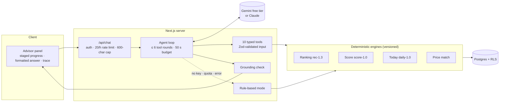
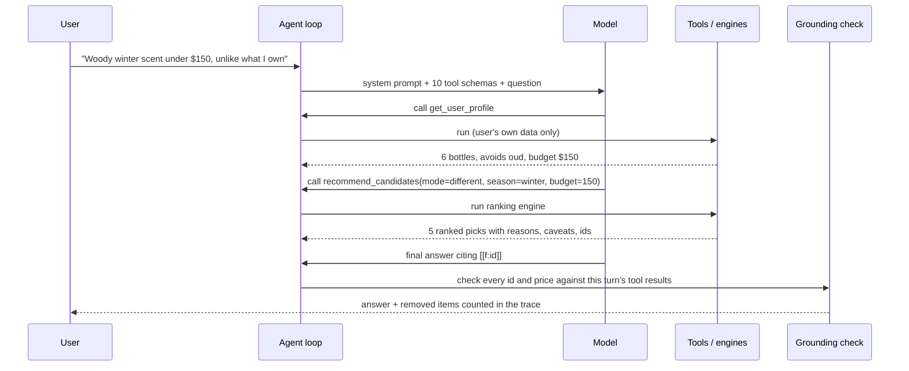

# Agent design: the Sillage advisor

*How the AI is built, constrained, tested and kept honest. Owner: Aditya Hasija. Updated 27 Oct 2026.*

## 1. The job

Answer plain-English questions about a person's own collection ("a woody winter scent under $150 that isn't like anything I own", "how balanced is my collection?", "what should I wear to the office tomorrow?") **using only facts Sillage can back up**.

## 2. Why an agent, and why only one

**Why an agent.** These questions take several dependent steps: read the shelf, translate "isn't like anything I own" into Different mode, set the season and budget, run the engine, look closer at the best pick, maybe price it, then explain. A single prompt can't do that reliably, and a fixed pipeline handles only one shape of question.

**Why only one.** There is one user, one context and one job. A multi-agent setup would add cost, latency and failure modes without adding capability, so it was left out on purpose ([D-004](../DECISIONS.md)).

**What it doesn't do.** It never ranks, scores or matches. Deterministic, versioned engines do that, and the agent calls them as tools. The numbers stay reproducible and testable; the language stays flexible.

## 3. Architecture

## 4. The loop

- Tool calls in one round run in parallel; all results return in one message.
- On the last allowed round the tools stay declared but the model must answer in text.
- History is replayed as plain text (last 10 turns), so no stale reasoning data is ever re-sent.

## 5. Tools: split by permission

| Tool | Kind | What it returns |
|---|---|---|
| `get_user_profile` | Read | Shelf summary: size, families, coverage, liked and disliked notes, budget |
| `get_owned_fragrances` | Read | Each owned bottle and how the user rated it |
| `search_catalog` | Read | Fragrances matching a name |
| `get_fragrance_details` | Read | Notes, accords, community votes; review themes **labelled untrusted** |
| `recommend_candidates` | Read | The ranking engine: mode, budget, season, time of day, price band, style |
| `find_offers` | Read | Exact-variant offers, with low-price and marketplace warnings |
| `get_collection_score` | Read | The Collection Score, strengths and gaps |
| `pick_for_today` | Read | A ranked pick from bottles the user owns |
| `propose_add_to_wishlist` | **Propose** | A confirm button; saves nothing |
| `propose_preference_update` | **Propose** | A confirm button; saves nothing |

There is no write tool. A prompt injection hidden in third-party text has nothing to trigger.

## 6. Guardrails

| Guardrail | Enforced in | Behaviour |
|---|---|---|
| **Grounding: products** | Code, after the model answers | Every cited id must have come from a tool this turn; others are removed and counted |
| **Grounding: prices** | Code | Every `$` amount must appear in a tool result; others become "[price not verified]" |
| **Price warnings** | Prompt + tool output | Low-price and marketplace flags must be mentioned next to that price |
| **Untrusted text** | Tool output labelling + prompt | Review themes are data, never instructions |
| **Input validation** | Zod on every tool call | Malformed input returns an error to the model, not a crash |
| **Budget** | Loop | ≤ 6 tool rounds; 50 s wall clock; 20 questions per user per hour |
| **No silent writes** | Tool design | Only "propose" tools; the user confirms in the UI |
| **Transparency** | UI | Model, rounds, latency, tokens, tool calls and grounding result under every answer |

## 7. Providers and resilience

The loop, tools, grounding and trace are provider-neutral; Gemini and Claude are thin adapters ([DEC-46](../DECISIONS.md)).

| Situation | What happens |
|---|---|
| `GEMINI_API_KEY` set (default) | Gemini free tier: `gemini-3.6-flash`, then `gemini-3-flash-preview`, `gemini-3.5-flash-lite`, `gemini-3.1-flash-lite` |
| A model is overloaded, out of quota, unavailable or times out at any round | The whole answer restarts on the next free model (each has its own quota); tools are re-run safely because they only read or propose |
| `ANTHROPIC_API_KEY` set | Claude (`claude-opus-5-5` by default), same loop |
| No key, all models failing, or a safety block | A labelled rule-based mode answers from the same engines |

Gemini's tool schemas are generated from the Claude ones; optional fields Gemini can't express are restored to `null` before the **same** validation runs, so there's one definition of what a tool accepts ([DEC-47](../DECISIONS.md)).

## 8. Narrow AI elsewhere

**Today's explanation** is one model call with no tools: it rewrites the ranker's factors as a sentence. It's accepted only if it names the pick, adds no numbers or prices, stays under 600 characters and ends like a sentence; otherwise the template sentence is shown. The UI labels which one you're reading. It runs on the Flash-Lite models so it never spends the advisor's quota, capped at 12 per user per hour.

## 9. How it's tested

| Layer | What | Result |
|---|---|---|
| Unit | Tool loop on both providers with scripted models: parallel calls, tool errors, round cap, quota and overload fallback, safety blocks, schema conversion, formatting | 119 tests pass |
| Adversarial eval | Model outputs with planted fake ids, real-but-unreturned ids, invented prices and price ranges | **0 of 7** reached the user |
| Offline answers | Score, wear and multi-price questions answered without a model | Covered by unit tests |
| Live eval | Eight real prompts, expectations written first (right tools, owned-only picks, no false "saved" claims, injection resistance) | Implemented; runs with a key in `.env.local`, published to `/evals` |

## 10. Known limitations

- Answers take 6–25 s on the free model; progress is staged, not streamed.
- The model can describe a fragrance with knowledge beyond the tool results (for example, a note it remembers). Grounding covers products and prices, not every descriptive claim.
- Gemini's free tier may use requests to improve Google's products; the privacy page says so.
