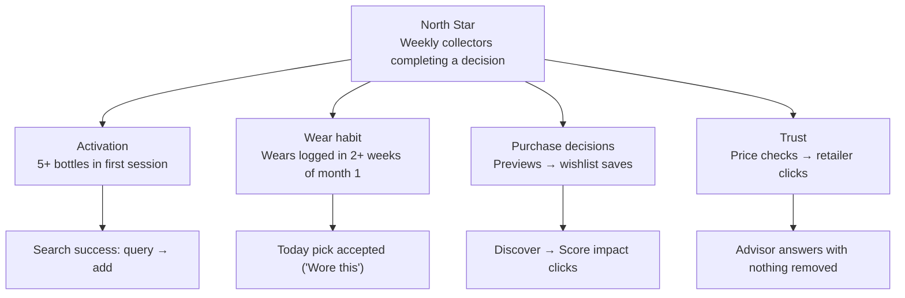

# Metrics and instrumentation

*How Sillage would know it's working, what's measured today, and what isn't yet. All targets are hypotheses: there are no real users yet.*

## North Star

> **Weekly active collectors who complete a decision**: unique signed-in users (demo sandboxes excluded) who, in a calendar week, log a wear, preview a purchase, or check a price.

**Why this metric.** Each of those actions is a moment where Sillage replaced a guess with an informed choice, which is the value the product promises. It rewards retention and real use, not sign-ups or page views, and it can't be gamed by AI chat volume alone.

## Metric tree

## Input metrics

| Metric | Definition | Why it matters | Hypothesis target | Source |
|---|---|---|---|---|
| **Activation** | % of new accounts that add ≥ 5 bottles in the first session | The shelf powers everything; below 5 the Score is provisional | ≥ 60% | `collection_items` by `created_at` |
| **Wear habit** | % of activated users who log a wear in ≥ 2 distinct weeks of their first 4 | Today is the retention loop | ≥ 30% | `wear_logs` |
| **Pick acceptance** | "Wore this" ÷ (Today runs with a pick shown) | Is the daily pick good enough to act on? | ≥ 25% | `daily_selector_run`, `daily_pick_feedback_submitted` |
| **Preview → wishlist** | Wishlist saves within 24 h of a Score preview, ÷ previews | The core purchase-decision value | ≥ 20% | `score_preview_completed`, `wishlist_items` |
| **Recommendation relevance** | "Relevant" ÷ all relevance votes in Discover | Ranking quality as users see it | ≥ 70% | `recommendation_feedback` |
| **Lab learning loop** | % of saved experiments with a logged wear within 14 days | Do predictions get tested? | ≥ 25% | `layering_experiment_saved`, `layering_feedback_submitted` |

## Guardrails

| Guardrail | Definition | Threshold | Source |
|---|---|---|---|
| **Grounding removals** | % of AI answers where the check removed an id or price | ≤ 5% (alert above 10%) | `chat_messages.tool_summary_json.grounding` |
| **Fallback rate** | % of advisor turns answered in rule-based mode | ≤ 15% | trace `mode`, `offlineReason` |
| **Advisor latency** | p50 and p90 time to answer | p50 ≤ 15 s, p90 ≤ 30 s | trace `latencyMs` |
| **Price precision** | Exact-match precision on a monthly labelled sample of 50 live listings | ≥ 95% | manual labelling (planned) |
| **Cost per answer** | Model spend per advisor answer | $0 on the free tier; ≤ $0.02 if moved to a paid model | trace `costUsd`, provider console |
| **Accessibility** | Serious or critical axe violations on app screens | 0 | CI end-to-end suite |

## What's instrumented today

| Signal | Status |
|---|---|
| Product events: `collection_score_viewed`, `score_preview_completed`, `daily_selector_run`, `daily_pick_feedback_submitted`, `layering_prediction_created`, `layering_experiment_saved`, `layering_feedback_submitted` | ✅ Insert-only `product_events` table with a name and property allowlist (no free text, no location) |
| Wears, Discover runs and relevance votes, advisor traces, offer snapshots | ✅ In their own tables, row-level secured |
| Retailer link clicks, wishlist-after-preview attribution, sign-up funnel | ⬜ Not yet (next instrumentation pass) |
| Dashboards | ⬜ None yet: with no users, the first readout is qualitative |

## How we'd read the first month

1. **Week 0: interviews.** Five collectors with 10+ bottles use the demo while thinking aloud. Questions: do they agree with their Score, would they open Today tomorrow, do they trust a shelf-aware pick more than a generic one?
2. **Weeks 1–4: a small cohort** (20–50 people from fragrance communities). Read activation and wear habit weekly; read relevance and preview → wishlist at week 4.
3. **Decision rule.** If wear habit is under 15% after four weeks, Today isn't a retention loop and the roadmap shifts toward purchase decisions; if preview → wishlist is under 10%, the Score isn't changing decisions and needs rethinking before more features.

## Anti-metrics

Things deliberately **not** optimised: number of advisor messages (more chat isn't more value), time on site, and the number of recommendations shown.
